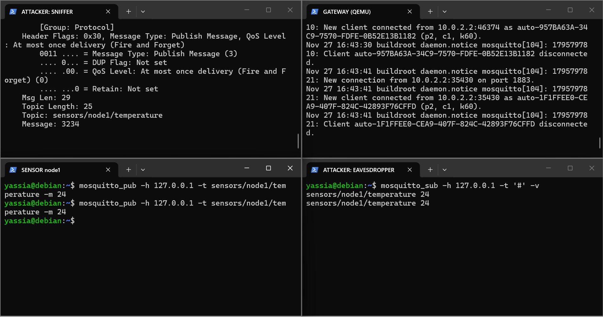
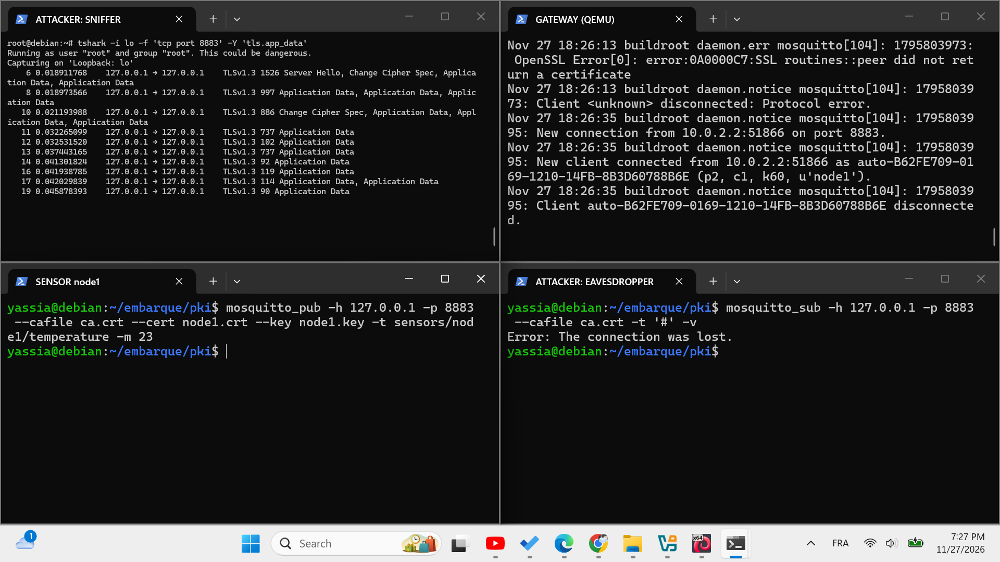
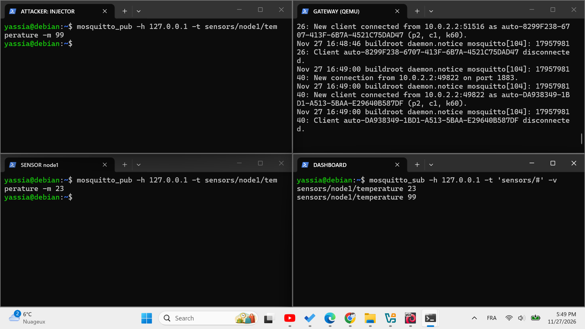
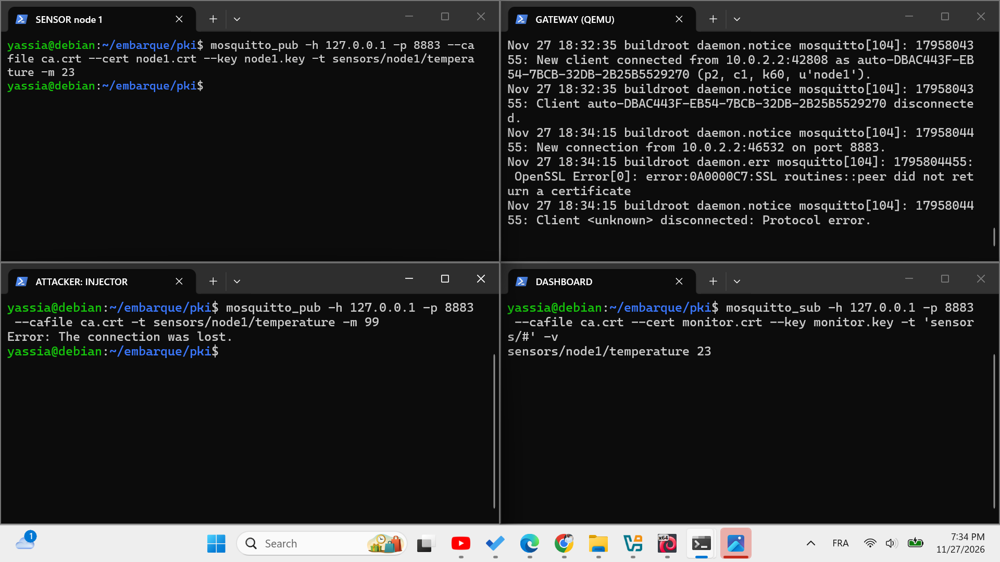

# Secure IoT Gateway — Phase A: Embedded Linux

Personal project: build, secure, then attack an IoT system end to end.
This phase covers the **base system of the gateway**: a minimal embedded Linux built with Buildroot, first explored in its default configuration, then hardened.

## Step 1 — Default build, analyzed before any change

---

## Reproduce

```bash
# 1. Buildroot (LTS branch)
git clone https://gitlab.com/buildroot.org/buildroot.git && cd buildroot
git checkout 2025.02.19

# 2. Secrets, generated locally and never committed
openssl passwd -6 > <repo>/gateway/br2-external/board/gateway/root-passwd-hash
<repo>/gateway/tools/gen-pki.sh        # lab PKI, written to ~/embarque/pki

# 3. Configure with the external tree, then build
make BR2_EXTERNAL=<repo>/gateway/br2-external gateway_defconfig
make

# 4. Boot (MQTT over TLS forwarded to 127.0.0.1:8883; clean shutdown: poweroff)
<repo>/gateway/run-qemu.sh
```

The build fails on purpose if the password hash or the broker's TLS material is missing.

Configuration: [`gateway_defconfig`](br2-external/configs/gateway_defconfig)

---

## 1. What Buildroot built

Built with **Buildroot 2025.02.19** (LTS branch), for an **ARM64 (Cortex-A53)** target using **glibc**.

**On the build machine** (x86-64 Debian):

| Component | Location | Details |
|---|---|---|
| Cross-compilation toolchain | `output/host/` | `aarch64-buildroot-linux-gnu`, GCC 13.4.0, built by Buildroot from source. Its sysroot (`output/staging`) holds development headers and libraries; none of it reaches the target, so the gateway has no compiler. |

**On the target** (what QEMU boots):

| Component | Location | Details |
|---|---|---|
| Bootloader | — | None: QEMU loads the kernel directly. |
| Kernel | `output/images/Image` | Linux 6.12.27 (LTS branch), 12 MB: three times larger than the rest of the system. |
| Root filesystem | `output/images/rootfs.ext2` | ext4 image of 60 MB, of which 4.3 MB used, generated from `output/target/`. Ownership and permissions (root owner, setuid bits) are only applied when the image is created, through fakeroot. QEMU uses this image as its disk, so changes made at runtime persist. |

**Emulated machine:** generic ARM64 `virt` board, 1 core, 128 MB of RAM. The rootfs is exposed as a virtio disk (`/dev/vda`), the console is on the serial port (`ttyAMA0`).

---

## 2. From power-on to `login:`

```
QEMU (acts as bootloader) → kernel with "root=/dev/vda console=ttyAMA0"
  → discovers hardware through the device tree (serial port, disk, network)
  → mounts the rootfs read-only
  → starts init (BusyBox, PID 1), which reads /etc/inittab:
       ├─ mounts /proc, /sys, tmpfs; remounts / read-write
       ├─ rcS: starts services in order (S01 → S50)
       └─ getty on the serial console → "buildroot login:"
```

|Service|Role|
|-|-|
|`seedrng`|Seeds the kernel random number generator (essential for cryptography)|
|`syslogd`, `klogd`|System and kernel logs|
|`sysctl`|Kernel parameters (an entry point for hardening)|
|`network`|Networking via DHCP|
|`crond`|Scheduled tasks|

> Killing QEMU abruptly (Ctrl+A X) is equivalent to a power cut: on the next boot, ext4 has to replay its journal (`recovery required`). This is why embedded systems often use a read-only rootfs.

---

## 3. The system in numbers

|Metric|Value|
|-|-|
|Disk space used|4 MB (vs. more than 8 GB for the Debian development VM)|
|RAM used|11 MB|
|System commands|A single BusyBox binary (~800 KB); every command is a symlink to it|
|Setuid files|1 (`/bin/busybox`)|
|Open network ports|0|

---

## 4. Security findings

|#|Finding|Fixed or Accepted|
|-|-|-|
|1|`root` has no password (empty field in `/etc/shadow`)|✅ Fixed: password hash kept outside Git, written into `/etc/shadow` by a post-build script (the build fails if it is missing)|
|2|Login prompt on the serial console (reachable through UART on real hardware)|Accepted for now: only access under QEMU; to restrict on real hardware|
|3|BusyBox is **setuid root**: an 800 KB binary that starts as root|✅ Fixed: setuid bit removed by a post-fakeroot script; the build fails if any setuid/setgid file remains. *Verified: `find / -xdev -perm -4000` returns nothing* |
|4|`crond` running with no use|✅ Fixed: `crond` and `crontab` disabled through a BusyBox config fragment. *Verified: no `crond` at boot, command not found*|
|5|`/tmp` and `/dev/shm` mounted without `nosuid,nodev,noexec`|✅ Fixed: `nosuid,nodev,noexec` set through a rootfs overlay. *Verified: a binary copied to `/tmp` gets `Permission denied`, even as root*|
|6|Unused `dummy0` and `sit0` interfaces|Accepted: no traffic on `dummy0`; `sit0` packets will be dropped by the default-deny firewall|
|7|IPv6 enabled|To be covered by the nftables firewall (`inet` table filters IPv4 and IPv6)|
|8|Exact kernel version and build information readable by any user|✅ Compiler hardening verified on target binaries with `readelf` (PIE, full RELRO, SSP strong); FORTIFY_SOURCE raised from 1 to 2: checked libc functions in BusyBox 12 → 19 (the `printf` family, blocking format-string `%n` writes). Kernel version left visible (hiding it is security by obscurity)|
|9| `gatewayd` runs as **root**: once it parses network data, any exploitable bug gives full control of the gateway |✅ Fixed: dedicated `gatewayd` user (no shell, no password); SELinux confinement planned|

**Already good:** no open ports, system accounts without a login shell (`/bin/false`), a single setuid file.

## Step 2 — External tree and first daemon

My own code lives in a **Buildroot external tree** (`br2-external/`), outside the Buildroot sources: Buildroot stays untouched and everything specific to the gateway is versioned here.

```
br2-external/
├── external.desc            # name: GATEWAY → defines BR2_EXTERNAL_GATEWAY_PATH
├── Config.in                # adds the package to menuconfig
├── external.mk              # includes every package recipe
├── configs/gateway_defconfig
├── board/gateway/           # post-build.sh, post-fakeroot.sh, busybox.fragment, rootfs-overlay/
├── package/gatewayd/        # Config.in, gatewayd.mk (generic-package), S90gatewayd
└── src/gatewayd/            # gatewayd.c, Makefile
```

**`gatewayd`** is a minimal daemon: it logs to syslog every 10 seconds and stops cleanly on `SIGTERM`. Its Makefile never hardcodes `gcc`: Buildroot passes its cross-compiler and flags through `$(TARGET_CONFIGURE_OPTS)`, so the same source builds for the host (quick tests) and for the ARM64 target.

**`S90gatewayd`** starts it at boot after the network (`S40network`), using BusyBox `start-stop-daemon` and a PID file; `stop` sends `SIGTERM`.

```
Starting network: OK
Starting crond: OK
Starting gatewayd: OK
```

**Rebuild the gateway image:**

```bash
make
```

---

## Step 3 — Hardening (Done)

**Baseline, before hardening:**

| Metric | Before | After |
|---|---|---|
| Kernel | 12 MB | 12 MB (kernel findings accepted, see below) |
| Root filesystem | 4.3 MB | 4.3 MB |
| BusyBox commands | 279, setuid root | 277, no setuid |
| Setuid/setgid files | 1 | 0 (the build fails otherwise) |
| Boot scripts | 7, of which 5 resident daemons | 6, of which 4 resident daemons |
| Writable mounts allowing execution (`/tmp`, `/dev/shm`) | 2 | 0 |
| Checked libc functions in BusyBox (FORTIFY_SOURCE) | 12 | 19 |
| RAM used | 11 MB | 11 MB |
| Open ports | 0 | 0 |
| Network interfaces | 4, IPv6 enabled | 4 (IPv6 to be filtered by nftables) |

On a system that is already minimal, hardening barely changes the size: the gain is in privileges (no setuid file, no unneeded root daemon, no execution from writable mounts).

> Known limit: `noexec` blocks direct execution, not a script read by an interpreter (`sh /tmp/script` still runs). Fewer interpreters and SELinux confinement address this later.

## Step 4 — MQTT broker secured with mutual TLS

Mosquitto runs on the gateway. It was first deployed deliberately open (plaintext, anonymous) to measure the attack surface, then locked down:

- **Mutual TLS** on port 8883 only: every client must present a certificate signed by the project CA; the plaintext port is gone.
- **Per-device ACLs**: the certificate's CN becomes the MQTT identity; `node1` may only publish to `sensors/node1/#`, `monitor` may only read.
- **Keys stay outside Git**: `tools/gen-pki.sh` builds the lab PKI in a separate folder; the post-build script copies only the broker's material into the image, and the build fails if it is missing.

| Before (open broker) | After (mutual TLS + ACL) |
|---|---|
|  |  |
|  |  |

---

## Next steps

- [x] Integrate a C daemon as a Buildroot package (external tree, `BR2_EXTERNAL`)
- [x] Audit and harden the default image (findings 1 to 9)
- [x] Mosquitto MQTT broker with mutual TLS and per-device ACLs
- [ ] nftables firewall (IPv4 and IPv6), default deny
- [ ] SELinux in enforcing mode, with a policy for the daemon
---

*References:* [*Buildroot manual*](https://buildroot.org/downloads/manual/manual.html) *· "Linux embarqué", Pierre Ficheux (Eyrolles)*

